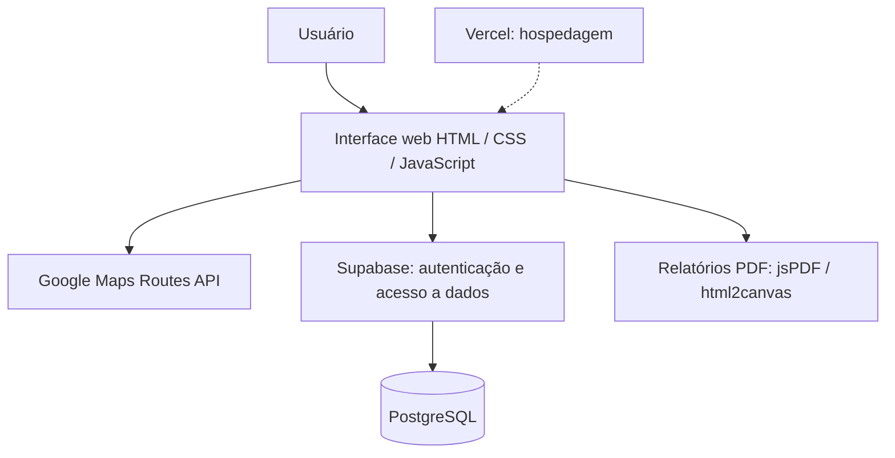

# FretePro

**Gestão logística e financeira para transportadoras — da estimativa de uma viagem ao acompanhamento dos resultados.**

[](https://fretepro.vercel.app) 

**[Acessar aplicação](https://fretepro.vercel.app)** · **[Repositório](https://github.com/balbaooo/fretepro)**

O **FretePro** é uma aplicação web que desenvolvi de forma independente a partir de uma necessidade real de uma transportadora. O sistema está em uso por uma empresa do setor e reúne planejamento de rotas, gestão de fretes, custos operacionais e acompanhamento financeiro em um único ambiente.

> **Sobre as imagens:** capturas reais da interface em uma conta sem movimentações cadastradas. Os valores zerados são os exibidos no sistema; a simulação numérica mais abaixo é **fictícia e apenas ilustrativa**, não representa resultados do cliente.

## Visão geral da aplicação

### Painel operacional


O painel reúne indicadores do período, caminhões cadastrados, quilômetros rodados, fretes recentes, contas a receber e abastecimentos.

### Calculadora de rotas e pedágios


Permite informar origem e destino, veículo, quantidade de eixos, consumo estimado, preço do diesel e valor do frete para apoiar a avaliação de custos da viagem. A aplicação integra informações de trajetos e distâncias via **Google Maps Routes API**.

### Cadastro e acompanhamento de fretes


Organiza dados de viagens, caminhões, motoristas, clientes, carga, quilômetros, pedágios, situação da viagem e pagamento, além de histórico e filtros.

### Demonstrativo de Resultados (DRE)


Consolida indicadores e categorias de receitas, custos operacionais e despesas financeiras, com visão por período e **exportação em PDF**.

### Gestão financeira


Oferece acompanhamento de receita, custos fixos e variáveis, custo por quilômetro, metas de faturamento, ponto de equilíbrio e comparativos entre períodos.

## Problema de negócio

No transporte rodoviário, o custo de uma viagem depende de fatores como distância, pedágios, combustível e características do caminhão. Quando informações de fretes, abastecimentos e finanças ficam distribuídas entre planilhas e serviços separados, o trabalho de consolidação aumenta.

O FretePro foi criado para **aproximar o planejamento operacional do controle financeiro**, permitindo consultar os dados no mesmo sistema e apoiar decisões do dia a dia.

## Funcionalidades

| Área | Recursos apresentados no sistema |
|---|---|
| **Rotas** | Origem, destino, distância, cálculo de pedágios por eixos e estimativas de combustível |
| **Operação** | Cadastro de fretes, caminhões e motoristas; status de viagem e pagamento |
| **Abastecimentos** | Registro e acompanhamento de custos de combustível |
| **Financeiro** | Receitas, gastos, contas a receber, metas, custos por km e ponto de equilíbrio |
| **DRE** | Receita bruta, EBITDA, EBIT, lucro líquido e detalhamento de custos |
| **Relatórios** | Demonstrativos e exportação em PDF |
| **Acesso** | Login e persistência de dados com Supabase |

## Diferenciais

- **Uso em contexto real:** criado a partir de uma demanda de uma empresa de transportes e utilizado em sua operação.
- **Visão integrada:** dados logísticos e financeiros reunidos em um só produto.
- **Regras específicas do setor:** cálculo de custos considerando rotas, consumo e quantidade de eixos.
- **Indicadores para decisão:** DRE, custo por km, metas, comparativos e ponto de equilíbrio.
- **Desenvolvimento independente:** levantamento do problema, implementação das funcionalidades, integrações e publicação da solução.

## Exemplo ilustrativo de planejamento de viagem

**Cenário hipotético, com valores inventados exclusivamente para demonstrar o raciocínio — não são valores retornados pela aplicação nem dados reais da transportadora.**

| Parâmetro | Valor ilustrativo |
|---|---:|
| Distância da viagem | 420 km |
| Consumo médio | 3,5 km/L |
| Preço do diesel | R$ 6,20/L |
| Combustível estimado | R$ 744,00 |
| Pedágios estimados (hipótese) | R$ 185,00 |
| Receita do frete (hipótese) | R$ 1.650,00 |
| Saldo antes de outros custos | R$ 721,00 |

Cálculo didático: **420 ÷ 3,5 × 6,20 = R$ 744,00** de combustível; **1.650 − 744 − 185 = R$ 721,00** antes de salários, manutenção, impostos, depreciação e demais despesas. Esse saldo **não é lucro líquido**.

> As tarifas reais de pedágio variam conforme praça, rota, categoria do veículo e regras vigentes. A origem exata das tarifas e a validação operacional do algoritmo ainda precisam ser documentadas a partir do código e do processo efetivamente adotado.

## Arquitetura (visão conceitual)



*Diagrama resumido com base na stack documentada; não substitui uma análise detalhada do código.*

## Stack

| Tecnologia | Aplicação |
|---|---|
| JavaScript | Interface interativa e regras de negócio |
| HTML / CSS | Estrutura e estilo da aplicação |
| Supabase / PostgreSQL | Autenticação e persistência relacional |
| Google Maps Routes API | Rotas e distâncias |
| jsPDF / html2canvas | Exportação de demonstrativos |
| Vercel | Deploy e hospedagem |
| Git / GitHub | Controle de versão |

## Desafios técnicos e decisões

**Rotas e custos:** conectar dados de trajetos a parâmetros operacionais como consumo e eixos do caminhão, traduzindo-os em informações úteis ao planejamento.

**Operação e finanças:** estruturar uma experiência que reúne registros de viagens, abastecimentos, pagamentos e indicadores financeiros sem exigir alternância entre várias ferramentas.

**Relatórios:** disponibilizar uma visão financeira por período e sua exportação em PDF.

**Pontos para aprofundar na documentação:** origem/atualização das tarifas, validação dos cálculos frente a despesas reais e detalhes de modelagem do banco. Esses procedimentos não devem ser presumidos sem verificação.

## Executando localmente

```bash
git clone https://github.com/balbaooo/fretepro.git
cd fretepro
npx serve .
```

A execução com dados e integrações requer configurar um projeto Supabase, as tabelas correspondentes e as credenciais públicas/restritas usadas pelo código. Consulte os arquivos do repositório para identificar onde configurar esses valores. **O esquema SQL e o processo de configuração ainda precisam ser documentados e testados antes de considerar este guia completo.**

## Segurança e privacidade

- Não exponha chaves privilegiadas, especialmente a `service_role` do Supabase.
- Configure e revise políticas de **Row Level Security (RLS)** nas tabelas acessíveis pelo cliente.
- Restrinja a chave do Google Maps aos domínios e serviços necessários.
- Não publique informações financeiras, dados pessoais ou credenciais do cliente.

*Essas são recomendações de segurança, não uma afirmação de que todas já foram auditadas no projeto.*


## ‍Autor

**Felipe Balbão Santos** · [GitHub](https://github.com/balbaooo)

---

*FretePro — software desenvolvido para resolver problemas reais do transporte rodoviário.*
